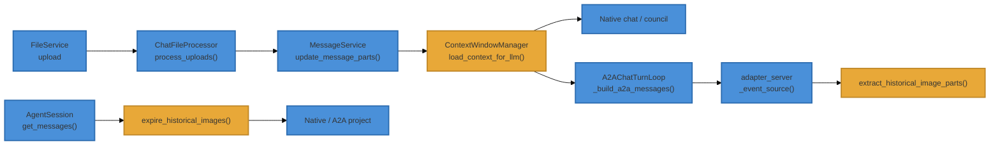

# Attachment Retention and Recall (Chat and Project)

> **Status**: Implemented (2026-09-26)
> **Scope**: Chat, chat council, and project; native and A2A execution
> **Related**: [A2A conversation history](a2a-conversation-history-parity.md),
> [Copilot vision support](a2a-copilot-vision-support-briefing.md)

## Current Contract

The original proposal to reload historical `file_ids` into A2A messages was
never implemented. Chat persists inline message parts, and the adapter extracts
recent images from that history. Retention limits **model-facing content**, not
stored assets or the user's ability to read project sandbox files.

| Mode | Historical model input | Explicit recall |
|------|------------------------|-----------------|
| Chat (native) | Context loader removes expired binary/image URL parts | Reprocess a same-session asset on the current turn |
| Chat (A2A) | Same filtered history; adapter reattaches recent images | Same chat preflight and upload path |
| Chat council | Same filtered history for members and synthesis | Same preflight; ambiguity stops before model calls |
| Project (native) | Expire copied agent history images and implicit tool images | Attach a selected asset through the run upload path |
| Project (A2A) | Same filtered agent history, forwarded with retention metadata | Same project preflight and upload path |

`AGENT_IMAGE_RETENTION_TURNS` defaults to `5`. Binary images and inline PDFs are
available on the upload turn and the next five **user** turns, then omitted
from model input. Assistant and tool messages do not advance the count; `0`
disables historical replay. Chat loads history before adding the current user
message, and project does the same, so the fifth follow-up can still see the
original upload; the sixth cannot. Expiry operates on copies of history and
does not delete or alter the original message or stored asset. Earlier text and
summaries may still refer to the attachment but do not replay its bytes.

## Recall And Ownership

Chat and council call `FileService.recall_for_turn()` before model execution;
project query and plan handlers call it before claiming a run. Resolution
considers only complete image/PDF assets linked to the **same session and user**.
An exact filename or ID takes precedence over a descriptive name match. One
unambiguous match is attached to the new turn and starts a fresh retention
window. An ambiguous reference returns candidate names for clarification,
without loading their bytes; no match asks for a filename or a new upload.
Explicitly supplied upload IDs must belong to the user before processing.

Chat and council persist processed upload parts for later turns, including
text-only extraction; turns without file IDs do not persist model-only prompt
context. Project recall passes the asset through the existing sandbox upload
and agent-run path. Recalled media undergoes the same provider/size checks as
a new upload. Tool-returned media is not an implicit recall mechanism.

## A2A And PDF Limits

`ContextWindowManager.load_context_for_llm()` filters chat/council history
before either provider path. Project copies `AgentSession.get_messages()` and
filters its images before a native call or A2A forwarding. Implicit project
tool images are limited to recent runs; sandbox PDFs remain available for
explicit file reads. The backend sends its configured retention limit in A2A
request metadata; standalone adapter requests use the environment default.

The adapter extracts recent historical image parts, plus the latest user's
parts, then converts **inline** PDF parts to bounded text before dispatch to
image-only Copilot and Claude-Code backends. Limits are 9 MB decoded PDF bytes,
50 pages, 8,000 characters per page, and 100,000 characters per PDF. URI-only
PDFs and scanned PDFs without extractable text fail explicitly. Native models
may process PDFs visually; A2A text extraction does not provide visual parity.
PDFs routed to text or vector-store processing by `ChatFileProcessor` are not
inline binary PDFs: extracted text is ordinary chat context, subject to normal
context compression rather than binary-part expiry. Project sandbox files can
still be read explicitly after image history expires.

Historical images are reattached by
`extract_historical_image_parts(req.messages, retention_turns=max(0, retention_turns))`.
There is no independent image byte/count cap beyond existing upload/provider
limits; turn expiry limits historical replay, not tool-returned media.

## Verification

Unit tests cover chat/council/project retention, explicit recall and access
checks, chat and council text-only upload persistence, A2A historical images,
retention metadata, and inline PDF extraction. `IMG-02` and `IMG-03` describe
earlier multi-turn image scenarios, but their recorded results do not verify
fifth/sixth-turn expiry or PDF recall. Those workflows still require live E2E
verification; scanned and URI-only PDF fidelity is not supported on the A2A
image-only path.