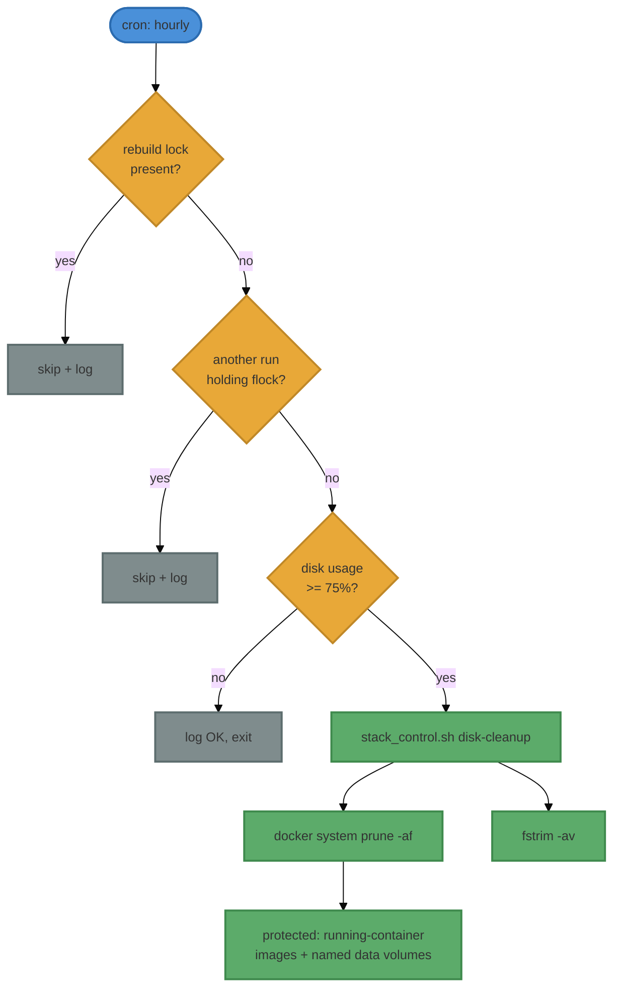

# Scheduled Disk Cleanup (cron)

**Purpose:** Document the cron job that keeps Docker disk usage in check on the
local WSL2 host, the exact `disk-cleanup` options it uses and why, and the safety
analysis proving it cannot harm the running stack.

**Scope:** Local Docker stack on WSL2 **only**. This automates the **Docker**
side of disk hygiene (images, build cache, stopped containers, build artefacts +
VHDX TRIM). It does **not** and **cannot** address non-Docker host floods such as
the subiquity log incident — see
[host-process-veth-churn-feedback-loop.md](host-process-veth-churn-feedback-loop.md)
for that class of failure. Production (E2B cloud) does not run this. Manual
recovery is in [docker-wsl2-recovery.md](docker-wsl2-recovery.md); in-backend
monitoring is in [host-resource-monitoring.md](host-resource-monitoring.md).

**Status:** Implemented and active 2026-06-10.

---

## What runs

| Item | Value |
|---|---|
| Wrapper script | `scripts/local/disk_cleanup_cron.sh` |
| Underlying command | `scripts/stack_control.sh disk-cleanup` (default options) |
| Schedule | Hourly, at minute 17 |
| Log | `logs/disk-cleanup-cron.log` (self-capped at 1 MiB) |
| Trigger threshold | root filesystem `/` usage ≥ **75%** (`DISK_CLEANUP_THRESHOLD`) |

Crontab entry:

```cron
17 * * * * /home/mdear/workspaces/git/ii-agent/scripts/local/disk_cleanup_cron.sh
```

## Which `disk-cleanup` options, and why

`scripts/stack_control.sh disk-cleanup` supports two flags. The cron job uses
**neither** — i.e. it runs with defaults — which is the safe, correct choice:

| Option | Cron uses it? | Reason |
|---|---|---|
| _(default: `docker system prune -af`)_ | yes | Removes stopped containers, dangling/unused images, unused networks, and build cache. Build cache + unused images are the usual local-disk hogs. |
| _(default: `fstrim -av`)_ | yes | Without TRIM, ext4 blocks freed inside WSL2 stay "used" from the VHDX's view, so the disk never actually shrinks. fstrim is read-safe and non-destructive. |
| `--prune-volumes` | **no** | Would run `docker volume prune -f`, which can delete the `postgres`, `redis`, `minio`, and filestore named volumes when the stack is stopped. **Never automate data-volume deletion.** |
| `--no-fstrim` | **no** | We _want_ fstrim; skipping it defeats the purpose of reclaiming VHDX space. |

So the automated command is exactly: `docker system prune -af` **+** `fstrim -av`,
with **no volume pruning**.

## When it acts (threshold gate)

The wrapper does nothing unless `/` is ≥ 75% full. Below that it logs `OK ... no
cleanup needed` and exits. This is deliberate:

- Under normal usage there is no image/cache churn — pruning when you have ample
  free space just forces needless image re-pulls/rebuilds later.
- Cleanup only kicks in under genuine disk pressure, where reclaiming space
  outweighs keeping pre-built but currently-unused images.

Override per-invocation with the env var, e.g. `DISK_CLEANUP_THRESHOLD=60`.

## Why it cannot harm the running stack



The five safety properties:

1. **Running containers and their images are never touched.** `docker system
   prune -af` only removes objects unreferenced by a running container. The six
   stack services (backend, frontend, postgres, redis, minio, a2a-adapter) are
   running, so their images are protected.
2. **The 7.3 GB sandbox image is protected.** `ii-agent-sandbox:latest` is the
   image of the always-on `a2a-adapter` service (and any warm pool containers),
   so prune cannot remove it — no surprise sandbox rebuilds.
3. **No data-volume deletion.** `--prune-volumes` is never passed, so
   postgres/redis/minio/filestore volumes are safe even if the stack is stopped.
4. **No overlap, no rebuild collision.** A `flock` guard prevents two runs from
   overlapping, and the job skips entirely if `/tmp/.ii-agent-rebuild-lock`
   exists (the same lock the systemd unit honors), so it never prunes mid-rebuild.
5. **The job cannot itself flood the disk.** Its log is self-capped at 1 MiB
   (trimmed to the last 500 lines), directly avoiding the irony of a
   disk-protection job becoming a disk-flood source.

`fstrim` and `docker system prune` are both online-safe: Docker documents prune
as safe against running workloads, and fstrim only discards already-free blocks.

## Prerequisites

- **Passwordless sudo for fstrim** (verified on this host): the `disk-cleanup`
  command calls `sudo fstrim -av`. cron has no TTY, so this must be non-interactive.
- **PATH**: the wrapper exports a full PATH (`/usr/sbin` for `fstrim`, `/usr/bin`
  for `docker`/`flock`) because cron's default PATH omits `/usr/sbin`.

## Operating it

```bash
# Inspect schedule
crontab -l

# Force a run now (respects the threshold gate)
scripts/local/disk_cleanup_cron.sh

# Force a run now regardless of free space (lower the gate for this invocation)
DISK_CLEANUP_THRESHOLD=0 scripts/local/disk_cleanup_cron.sh

# Watch results
tail -f logs/disk-cleanup-cron.log

# Disable
crontab -l | grep -v disk_cleanup_cron.sh | crontab -
```

## What this does NOT cover

- **Non-Docker host floods** (e.g. `/var/log/installer` from a runaway snap) — see
  [host-process-veth-churn-feedback-loop.md](host-process-veth-churn-feedback-loop.md).
- **VHDX physical shrink** — `fstrim` marks blocks discardable, but actually
  shrinking `ext4.vhdx` still requires `wsl --shutdown` +
  `Optimize-VHD -Mode Full` from the Windows host (see
  [postgres-recovery-mode-failures.md](postgres-recovery-mode-failures.md)).

## Related

- [docker-wsl2-recovery.md](docker-wsl2-recovery.md) — manual Docker recovery.
- [host-resource-monitoring.md](host-resource-monitoring.md) — in-backend disk/memory monitoring.
- [host-process-veth-churn-feedback-loop.md](host-process-veth-churn-feedback-loop.md) — the non-Docker disk-flood failure mode.
- [postgres-recovery-mode-failures.md](postgres-recovery-mode-failures.md) — VHDX compaction workflow.
