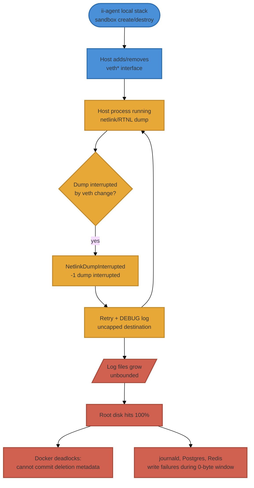

# Host Process × Sandbox veth Churn — Negative Feedback Loop

**Purpose:** Document a class of operational failure where a **host-level process**
on the WSL2 box reacts to the constant network-interface churn produced by
ii-agent's local Docker sandboxes, enters a retry-and-log loop, and escalates
into a host-wide outage (here: a 914 GB log flood that filled the root disk).

**Scope:** Local Docker sandbox mode on WSL2 **only**. The amplifier is the
`veth*` create/destroy churn described in
[sandbox-networking-design.md](sandbox-networking-design.md). **This failure mode
cannot occur in production** — the E2B cloud path has no host bridge, no `veth`
pairs, and no shared host kernel for a co-tenant process to observe (see
"Two deployment modes — keep them separate" in that doc). WSL kernel/host tuning
is in [wsl2-host-configuration.md](wsl2-host-configuration.md); recovery
procedure is in [docker-wsl2-recovery.md](docker-wsl2-recovery.md); in-backend
resource monitoring is in [host-resource-monitoring.md](host-resource-monitoring.md).

**Status:** First observed and resolved 2026-06-10. Root cause confirmed.

---

## TL;DR

ii-agent's local sandboxes are short-lived Docker containers. Every create/destroy
adds and removes a `veth*` interface on the host. **Any host process that watches
the network namespace** (via netlink / `RTNL` dumps) is interrupted by that churn.
If such a process retries-and-logs on every interruption, and its logs are
uncapped, the local ii-agent workload becomes the engine that drives a host
process to fill the disk — a negative feedback loop the application never sees.

On 2026-06-10 the watcher was a stray `ubuntu-desktop-installer` (subiquity) snap
daemon. It wrote **914 GB** to `/var/log/installer/` and took the host to 100%
disk, which then deadlocked Docker (a full disk cannot commit deletion metadata).

## The loop



The application side (node A) is behaving correctly — sandbox churn is normal and
expected. The damage is produced entirely by an **uninvited host co-tenant**
(nodes C–F) that nobody asked to watch the network namespace.

## Why ii-agent is the amplifier (but not the bug)

- Sandbox lifecycle is intentionally high-churn: pool warming, claim/release, and
  orphan cleanup all create and destroy containers, each with its own `veth` pair.
  See [sandbox-networking-design.md](sandbox-networking-design.md) and the orphan
  cleanup pipeline in `agents/sandboxes/orphan_cleanup.py`.
- A `veth` add/del is a netlink event. Any process doing an `RTNL` link/addr dump
  at that moment gets `NetlinkDumpInterrupted (-1, 'dump interrupted')` and must
  restart the dump. Under steady sandbox churn the dump **never completes**.
- If the watcher logs each retry at DEBUG with no rotation cap, the only ceiling
  is free disk. ii-agent supplies an effectively infinite stream of interruptions;
  the watcher supplies the unbounded writes.

**ii-agent's own cleanup systems do not and cannot catch this.** `orphan_cleanup.py`
and `scripts/stack_control.sh disk-cleanup` only reclaim Docker objects. The disk
consumer here is a non-Docker host process writing to `/var/log`. Application-level
disk monitoring (see [host-resource-monitoring.md](host-resource-monitoring.md))
sees host disk pressure but cannot attribute or stop a foreign host daemon.

## The 2026-06-10 instance — subiquity snap

| Fact | Value |
|---|---|
| Watcher process | `ubuntu-desktop-installer` snap → `subiquity-server` daemon |
| Daemon definition | `daemon: simple`, `restart-condition: always` (snap.yaml) |
| Snap installed | 2026-04-05 ~10:39 EDT (alongside a desktop snap set: chromium, gnome-46-2404, cups, mesa-2404, gtk-common-themes) |
| Started running | same minute as install; auto-started and auto-restarted ever since |
| Log destination | `/var/log/installer/subiquity-server-{debug,info}.log.<PID>` — no rotation cap |
| Peak damage | PID 1592 wrote 464 GB debug + 450 GB info = **914 GB** |
| Crash-loop evidence | dozens of historical `.log.<PID>` files across Apr–May (repeated respawns) |
| Disk outcome | 100% full / 0 bytes free → 42% (847 GB free) after fix |

Why it had no business running: subiquity is the **Ubuntu OS installer**. On an
already-installed WSL2 box it has nothing to install, yet the snap ships an
always-restart daemon that snapd enabled and started on install. It sat idle for
weeks until sustained sandbox churn turned its netlink dumps into an infinite
retry-log loop.

## Detection

Symptoms that should make you suspect *this* loop rather than Docker bloat:

- `df` shows 100% / 0 bytes free, but `docker system df` numbers look legitimate
  and `docker ... prune` frees nothing (or deadlocks — a 0-byte disk cannot write
  deletion metadata).
- `du` scans of `/` time out under I/O starvation.
- A single non-Docker directory under `/var/log` dominates usage.

Pinpoint the writer **without installing anything** (py-spy etc. cannot be
installed at 0 bytes free):

```bash
# Top writers by bytes written, from /proc (works at 0 free)
for p in /proc/[0-9]*; do
  w=$(awk '/write_bytes/{print $2}' "$p/io" 2>/dev/null)
  [ -n "$w" ] && echo "$w $(cat "$p/comm" 2>/dev/null) ${p##*/}"
done | sort -rn | head

# Confirm space pinned by deleted-but-open FDs (held until the process dies)
sudo lsof 2>/dev/null | grep -i deleted | sort -k7 -rn | head

# Identify the offending unit/snap
ps -p <PID> -o pid,cmd
```

## Remediation (and why order matters)

1. **Stop + disable the watcher** (do not merely `kill` — an `always`-restart
   daemon respawns and re-pins FDs):
   ```bash
   sudo snap stop ubuntu-desktop-installer
   sudo snap disable ubuntu-desktop-installer   # survives WSL reboot
   sudo pkill -9 -f subiquity                   # release pinned deleted FDs
   ```
2. **Delete the flood logs** to actually return free space:
   ```bash
   sudo rm -f /var/log/installer/subiquity-server-*.log.*
   ```
   Until the holding process is dead, deleting open log files frees nothing —
   that is why step 1 precedes step 2.
3. **Restart the stack** once free space exists: `./scripts/stack_control.sh start`.
4. **Permanent (recommended):** remove the snap so it cannot be re-enabled:
   ```bash
   sudo snap remove ubuntu-desktop-installer
   ```

## Post-incident corruption audit (2026-06-10: none required)

A 0-byte-free window can corrupt in-flight writes, so audit after recovery:

- **ext4:** `sudo dumpe2fs -h /dev/sdd | grep state` → `clean`; still `rw`; no
  ext4/I-O errors in `dmesg`. (Mount uses `errors=remount-ro`, so a hard error
  would have forced read-only — it did not.)
- **journald:** files flagged "corrupted or uncleanly shut down" during the window;
  journald self-heals (rename+replace). `journalctl --verify` → all **PASS** after
  it settles.
- **Postgres:** clean automatic WAL recovery on restart (`redo done`, checkpoint
  completed); data intact. **DB creds here are `user=iiagent db=iiagentdev`** — not
  `postgres`/`ii_agent`. See also
  [postgres-recovery-mode-failures.md](postgres-recovery-mode-failures.md).
- **Redis:** `PING` → `PONG`; no persistence errors in the container log.
- **Docker daemon:** healthy once free space returns.

## Prevention / hardening

- **Remove OS-installer / desktop snaps from WSL2 hosts.** They serve no purpose
  here and ship always-restart daemons. Audit: `snap list`. Prime suspects for
  network-watching daemons: `ubuntu-desktop-installer`, anything bundling a
  netlink/`probert`/NetworkManager-style watcher.
- **Cap journald** so the system journal cannot itself run away: set
  `SystemMaxUse=2G` in `/etc/systemd/journald.conf` (currently unset → relies on
  the 4 GB default; non-journald `/var/log` paths like `/var/log/installer` are
  not covered by this and need the snap removed).
- **External heartbeat.** `./scripts/stack_control.sh verify` reports disk % and
  inodes; run it from a Windows scheduled task (see the heartbeat note in
  [host-resource-monitoring.md](host-resource-monitoring.md)) so disk pressure is
  caught before 100%.
- **Generalised rule:** any host daemon that performs `RTNL`/netlink interface
  dumps is incompatible with a high-churn local Docker sandbox host. Treat its
  presence as a misconfiguration, not a tuning problem.

## Related

- [sandbox-networking-design.md](sandbox-networking-design.md) — local Docker
  `veth`/bridge topology that produces the churn (and why E2B is immune).
- [wsl2-host-configuration.md](wsl2-host-configuration.md) — host kernel/WSL tuning.
- [docker-wsl2-recovery.md](docker-wsl2-recovery.md) — Docker-on-WSL2 recovery.
- [host-resource-monitoring.md](host-resource-monitoring.md) — in-backend disk /
  memory / dockerd health monitoring.
