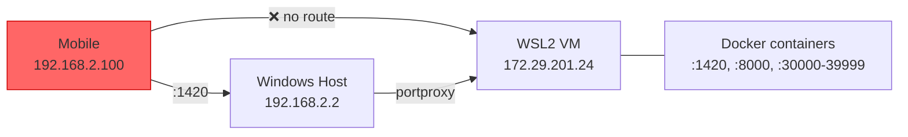

# WSL2 LAN Port Forwarding

**Purpose:** Document how to expose ii-agent services (frontend, backend, sandbox ports) to LAN devices (mobile, tablets, other machines) when running under WSL2 NAT mode.

**Scope:** Windows-side netsh portproxy rules, Windows Firewall inbound rules, and the automation that re-applies them on every WSL2 restart.

**Last reviewed:** 2026-06-18 (initial setup).

---

## Problem

WSL2 uses NAT networking by default. The WSL2 VM gets a private IP on an internal vSwitch (e.g. `172.29.x.x`), while the Windows host keeps its LAN IP (e.g. `192.168.2.2`).

Windows automatically forwards `localhost` traffic to WSL2, but **only from the Windows host itself**. Other LAN devices hitting `192.168.2.2:1420` reach Windows — which has nothing listening — and the connection is refused.



## Solution

The script [`scripts/local/windows-port-forward.ps1`](../../scripts/local/windows-port-forward.ps1) creates:

1. **netsh portproxy rules** — forward `0.0.0.0:<port>` on Windows to the current WSL2 internal IP for:
   - Port 1420 (frontend)
   - Port 8000 (backend)
   - Ports 30000–39999 (sandbox pool: noVNC, code-server, Vite, preview, etc.)

2. **Windows Firewall inbound rules** — allow TCP on those ports through Windows Defender Firewall.

The WSL2 IP changes on every VM restart, so the script must be re-run each time.

## Running manually

From an **admin PowerShell** on Windows:

```powershell
# Navigate to the script
cd \\wsl.localhost\Ubuntu-22.04\home\mdear\workspaces\git\ii-agent\scripts\local

# Remove stale rules from a previous WSL IP, then apply fresh ones
powershell -ExecutionPolicy Bypass -File .\windows-port-forward.ps1 -Reset
powershell -ExecutionPolicy Bypass -File .\windows-port-forward.ps1
```

Or if you've set `RemoteSigned` policy (`Set-ExecutionPolicy -Scope CurrentUser -ExecutionPolicy RemoteSigned`):

```powershell
.\windows-port-forward.ps1 -Reset
.\windows-port-forward.ps1
```

## Automation (run on every WSL2 start)

The Windows recovery task and WSL boot hook keep port forwarding current without an interactive shell:

### 1. Windows Scheduled Task (covers host reboot and user logon)

The tracked recovery monitor owns the `ii-agent WSL2 Port Forward` task. Its installer copies the monitor to `C:\ProgramData\ii-agent` and registers startup and logon triggers on the **same** task. The task never needs the WSL share at boot. In Administrator PowerShell, start WSL and check that the source share exists before installing:

```powershell
wsl.exe -d Ubuntu-22.04 -- true
$repoRoot = "\\wsl.localhost\Ubuntu-22.04\home\mdear\workspaces\git\ii-agent"
$installer = Join-Path $repoRoot "scripts\local\windows\install-ii-agent-recovery-monitor.ps1"
if (-not (Test-Path -LiteralPath $installer)) { throw "WSL share unavailable: $installer" }
powershell.exe -NoProfile -ExecutionPolicy Bypass -File $installer -InstallStartupTask
if ($LASTEXITCODE -ne 0) { throw 'Recovery task installation failed.' }
```

See [II-Agent WSL2 Power Recovery](ii-agent-wsl2-power-recovery.md) for Linux prerequisites, Windows credential requirements, and post-reboot verification.

### 2. WSL boot hook (covers `wsl --shutdown` without host reboot)

Added to `/etc/wsl.conf`:

```ini
[boot]
systemd=true
command=/mnt/c/Windows/System32/schtasks.exe /Run /TN "ii-agent WSL2 Port Forward" >/dev/null 2>&1 || true
```

This fires the same Scheduled Task whenever the WSL2 VM starts. The `schtasks.exe /Run` call returns immediately (non-blocking) and the `|| true` ensures WSL boot isn't affected if the task doesn't exist yet.

### How the two mechanisms interact

| Event | What fires | Blocking? |
|-------|-----------|-----------|
| Host reboot before user logon | Scheduled Task `AtStartup` trigger | No — runs from a Windows-local script |
| User logon | Same task's `AtLogOn` trigger | No — ignored if already running |
| `wsl --shutdown` → next WSL launch | `[boot] command=` triggers the task | No — `schtasks /Run` returns immediately |
| Update source monitor | Re-run the installer to deploy the new copy | N/A |

## Verification

After the script runs, from any LAN device:

- **Frontend:** `http://192.168.2.2:1420`
- **Backend:** `http://192.168.2.2:8000`
- **Sandbox previews:** `http://192.168.2.2:<port>` (ports 30000–39999)

From the Windows host, verify rules are active:

```powershell
netsh interface portproxy show all
```

## Removing all rules

```powershell
powershell -ExecutionPolicy Bypass -File .\windows-port-forward.ps1 -Reset
```

To also remove the Scheduled Task:

```powershell
Unregister-ScheduledTask -TaskName "ii-agent WSL2 Port Forward" -Confirm:$false
```

To remove the boot hook, edit `/etc/wsl.conf` inside WSL and delete the `command=` line.

## Troubleshooting

| Symptom | Cause | Fix |
|---------|-------|-----|
| Script blocked by execution policy | Default `AllSigned` or `Restricted` policy | Use `powershell -ExecutionPolicy Bypass -File ...` or set `Set-ExecutionPolicy -Scope CurrentUser RemoteSigned` |
| Ports unreachable after WSL restart | WSL2 got a new IP, stale portproxy rules | Re-run the script (or verify automation is working) |
| Sandbox previews work on localhost but not LAN | Port outside 30000–39999 range | Check `SANDBOX_PORT_RANGE_START`/`_END` in `docker/docker-compose.local.yaml` matches the script |
| Task not running at boot | Task not registered, or user changed | Re-register per instructions above |
